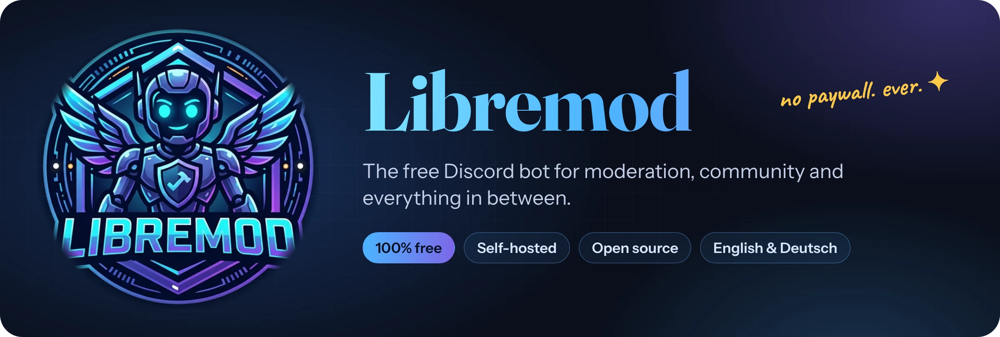
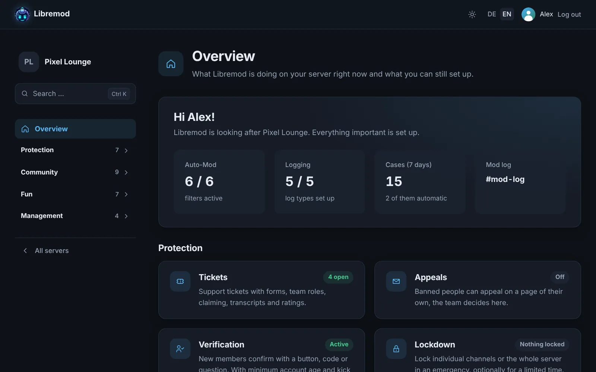
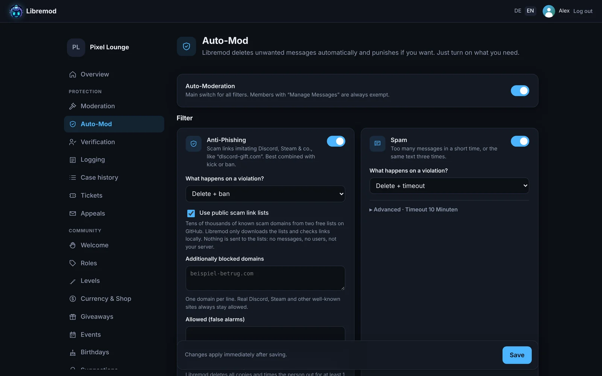
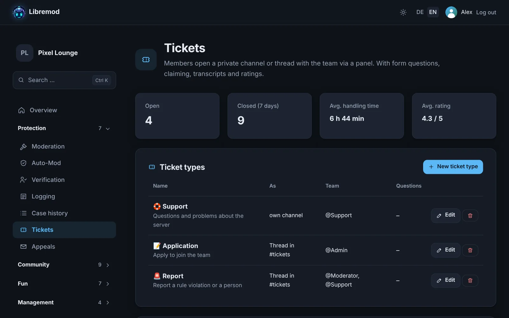
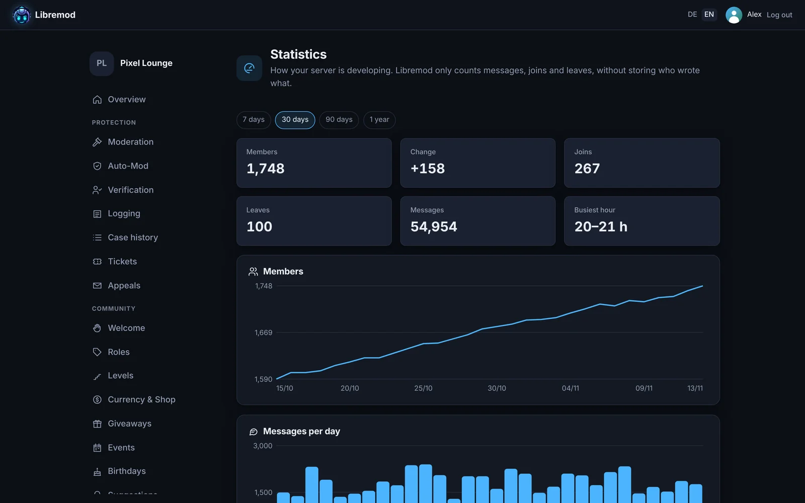
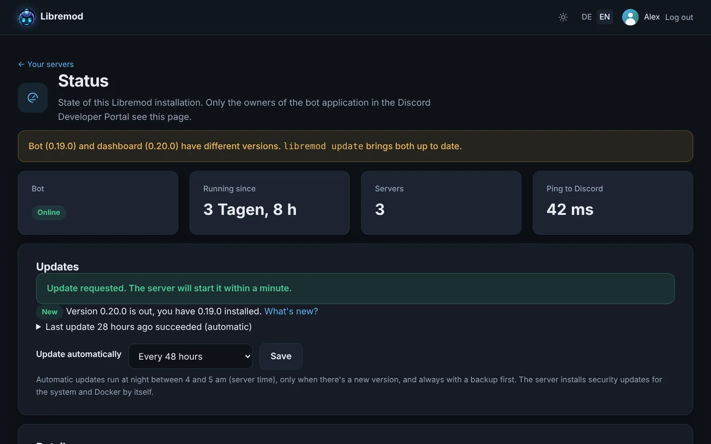
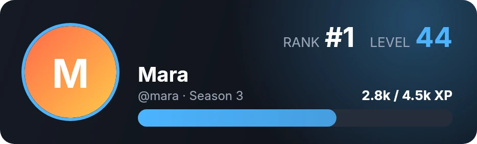
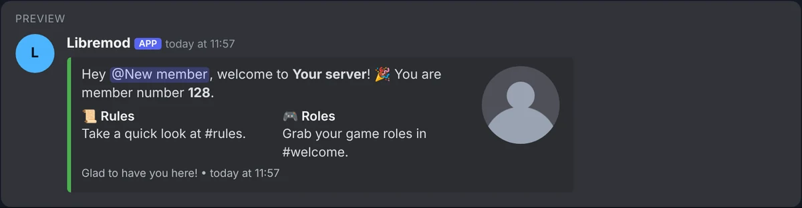

<div align="center">



<br>

[](LICENSE)
[](ROADMAP.md)
[](docs/SELBSTHOSTEN.md)
[](https://discord.js.org)
[](#why-libremod)

[Deutsch](README.md) · **English**

[Features](#features) · [Screenshots](#a-quick-look) · [Installation](#up-and-running-in-5-minutes) · [Commands](#commands) · [Privacy](#privacy) · [Contributing](#contributing)

</div>

---

Libremod moderates your Discord server, welcomes new members, hands out XP and roles, runs tickets, hosts giveaways and a whole lot more. Everything is configured comfortably in the **web dashboard**.

The twist: **every feature is free.** No premium tiers, no limits to buy your way out of, no "upgrade for $4.99 a month". Libremod runs on your own server, belongs to you and reports to no one.

## Why Libremod?

<table>
<tr>
<td width="50%" valign="top">

### 💸 Actually free
Many bots lock the good stuff behind a paywall: more role rewards, custom commands, welcome images. Libremod doesn't. Everything is unlocked for every server, forever.

</td>
<td width="50%" valign="top">

### 🏠 Your data stays with you
Libremod runs on your own server. No telemetry, no central service, no ads. Statistics only count numbers, never who wrote what.

</td>
</tr>
<tr>
<td width="50%" valign="top">

### ⚡ Set up in 5 minutes
An install script asks for everything it needs, checks your Discord credentials and sets up the database, dashboard, HTTPS and daily backups. Updates take one click in the dashboard, or happen automatically.

</td>
<td width="50%" valign="top">

### 🌍 English and German
Bot and dashboard speak both languages. You pick the bot's language per server, and everyone sees slash commands in their own Discord language.

</td>
</tr>
</table>

## A quick look

<div align="center">

<sub><b>Overview</b>: everything Libremod is doing on your server, at a glance.</sub>
</div>

<br>

<table>
<tr>
<td width="50%"><br><sub><b>Auto-mod</b>: spam, scam links, invites, word filter and more.</sub></td>
<td width="50%"><br><sub><b>Tickets</b>: ticket types, forms, transcripts, ratings.</sub></td>
</tr>
<tr>
<td width="50%"><br><sub><b>Statistics</b>: growth and activity, without storing any content.</sub></td>
<td width="50%"><br><sub><b>Status</b>: version, connection and backups of your installation.</sub></td>
</tr>
</table>

<table>
<tr>
<td width="50%" align="center"><br><sub><code>/rank</code> shows a rank card in your favourite colour.</sub></td>
<td width="50%" align="center"><br><sub>A welcome image for every new member.</sub></td>
</tr>
</table>

<div align="center">
<br>
<sub>Design embeds with a Discord-style <b>live preview</b> and placeholders like <code>{user}</code> and <code>{server}</code>.</sub>
</div>

## Features

<table>
<tr>
<td width="50%" valign="top">

#### 🛡️ Protection
- **Moderation**: warn, timeout, kick, ban (temporary too), purge, case log with reasons
- **Warning thresholds**: automatic timeout or ban after X warnings
- **Auto-mod**: spam, invites, links, word filter (catches tricks like "1d10t"), caps, mass mentions
- **Anti-phishing**: spots fake Discord and Steam links, URL shorteners and typical scam texts, plus two free lists with tens of thousands of known scam domains
- **Raid protection** and **name protection** against people impersonating your team
- **Verification** of new members via button, code or a custom question
- **Lockdown** of single channels or the whole server
- **Mass actions** against raids, **staff notes**, **ban appeals** on their own page
- **Logging**: deleted and edited messages, joins, roles, channels, voice channels

</td>
<td width="50%" valign="top">

#### 💬 Community
- **Welcome and goodbye** with embed, welcome image and direct message
- **Roles**: auto roles on join, self-assignable roles via buttons or menus, temporary roles, voice channel role
- **Tickets** with ticket types, form questions, staff roles, claiming, transcripts and ratings
- **Custom commands** like `/rules`, optionally with random replies
- **Scheduled messages**: daily, weekly or at fixed intervals
- **Notifications** for YouTube, Twitch, Kick, Reddit and RSS
- **Suggestions** with voting, **quotes**, **highlights**
- **Temporary voice channels**, **counter channels**, automatic channel clearing, auto slowmode

</td>
</tr>
<tr>
<td width="50%" valign="top">

#### 🎉 Fun and rewards
- **Levels** for messages and voice time, rank card, leaderboard, role rewards, bonus roles, seasons with a hall of fame
- **Server currency** with daily bonus, work, transfers and a **shop** for roles and custom items
- **Giveaways** with requirements and fair drawing
- **Events** with RSVPs, waiting list and reminders
- **Polls**, **reminders**, **birthdays**
- **Counting channel** and **word chain**

</td>
<td width="50%" valign="top">

#### ⚙️ Management
- **Web dashboard** with Discord login, works great on mobile too
- **Team access**: moderators only see the sections you allow
- **Audit log**: who changed what and when
- **Statistics** on members and activity
- **Export and import** of all settings, even to other servers
- **One-click updates** in the dashboard or automatically overnight, optionally security updates for the system and Docker too
- **Status page** and the `libremod` command for logs and backups
- **English and German** in bot and dashboard

</td>
</tr>
</table>

What's coming next and what arrived in which version is in the [roadmap](ROADMAP.md) (German).

## Up and running in 5 minutes

You need a Linux server (Debian or Ubuntu; 1 GB RAM is enough, a Raspberry Pi works too) and a Discord account.

**1. Create the bot on Discord**

Create a new application in the [Discord Developer Portal](https://discord.com/developers/applications). Under **Bot**, copy the token and enable the two **Privileged Gateway Intents** *Server Members* and *Message Content*. Under **OAuth2**, copy the client secret.

**2. Run the install script**

```bash
curl -fsSL https://raw.githubusercontent.com/libremod-bot/libremod/main/deploy/install.sh -o install.sh
sudo bash install.sh
```

The script asks for your token and client secret, verifies them with Discord, installs Docker if needed and sets up the database, dashboard, HTTPS (via Let's Encrypt), a daily backup and, if you like, automatic updates.

**3. Done**

At the end you get the dashboard address and an invite link for your server. Add the redirect address the script shows you in the Developer Portal under **OAuth2 → Redirects**.

> [!TIP]
> The detailed guide with Developer Portal walkthrough, your own web server (nginx, Apache), moving servers and troubleshooting is in **[docs/SELBSTHOSTEN.md](docs/SELBSTHOSTEN.md)** (currently in German).

### Updates

The dashboard's status page tells you when a new version is out; one click on **Update now** is all it takes. Or let Libremod update itself overnight (every 24 or 48 hours, chosen during installation or in the dashboard). A backup is made before every update. The dashboard gets no access to your server for this: a small service on the server picks up the request.

### Day to day: the `libremod` command

| Command | What it does |
| --- | --- |
| `libremod status` | Shows whether everything is running and when the last backup ran |
| `libremod update` | Fetches the latest version, with an automatic backup first |
| `libremod autoupdate 24` | Turn on automatic updates (`48` or `off` work too) |
| `libremod logs bot` | Follow the bot's log output live |
| `libremod backup` / `restore` | Back up the database or restore a backup |
| `libremod config` | Edit settings and restart |
| `libremod restart` | Restart everything |

<details>
<summary><b>Without the install script: Docker Compose from source</b></summary>

<br>

```bash
git clone https://github.com/libremod-bot/libremod.git
cd libremod
cp .env.example .env        # fill in token, client ID, client secret, dashboard URL and passwords
docker compose up -d --build
docker compose run --rm bot node dist/deploy-commands.js   # register slash commands
```

Database migrations run automatically when the bot starts. The dashboard only listens locally on port 3000 (`DASHBOARD_PORT`); put a reverse proxy with HTTPS in front of it. In the Developer Portal, `<DASHBOARD_URL>/api/auth/callback` must be listed under **OAuth2 → Redirects**.

Prebuilt images are available too: `ghcr.io/libremod-bot/libremod-bot` and `ghcr.io/libremod-bot/libremod-dashboard` (amd64 and arm64).

</details>

<details>
<summary><b>Setting up live stream alerts for Twitch and Kick</b></summary>

<br>

YouTube, Reddit and RSS feeds work without credentials. For Twitch and Kick your installation needs its own free application on the platform:

- **Twitch:** Create an application at [dev.twitch.tv/console/apps](https://dev.twitch.tv/console/apps) (OAuth redirect e.g. `http://localhost`), then add `TWITCH_CLIENT_ID` and `TWITCH_CLIENT_SECRET` to your `.env`.
- **Kick:** Create an application at [kick.com/settings/developer](https://kick.com/settings/developer), then add `KICK_CLIENT_ID` and `KICK_CLIENT_SECRET`.

Then run `libremod restart`. Without these values the platform is greyed out in the dashboard.

</details>

<details>
<summary><b>Which permissions does the bot need?</b></summary>

<br>

The invite link from the dashboard requests everything it needs. In detail:

- **Kick Members**, **Ban Members** and **Timeout Members** for moderation
- **Manage Messages** and **Read Message History** for auto-mod, purge, highlights and channel clearing
- **Manage Roles** for auto roles, role panels, level rewards and verification
- **Manage Channels** and **Move Members** for counter channels, temporary voice channels, lockdown and slowmode
- **Manage Threads**, **Create Private** and **Public Threads**, **Send Messages in Threads** for tickets and suggestions
- **Send Messages**, **Embed Links**, **Attach Files**, **Add Reactions**, **Create Polls**
- **Mention @everyone** only if your notifications should do that

Libremod's role must sit above the roles it should assign or moderate in the role list.

</details>

## Commands

Almost everything is set up in the dashboard. In chat you have these slash commands:

<details open>
<summary><b>🛡️ Moderation and protection</b></summary>

<br>

| Command | Purpose |
| --- | --- |
| `/warn` | Warning with a reason |
| `/timeout`, `/untimeout` | Mute for a duration (e.g. `10m`, `2h`, `1d`) |
| `/kick` | Remove from the server |
| `/ban`, `/unban` | Ban, optionally temporary (`duration: 7d`), expires on its own |
| `/purge` | Clean up to 100 messages, optionally from one person only |
| `/cases`, `/case show/reason/revoke` | View the case log, edit reasons, revoke warnings |
| `/lockdown channel/server`, `/unlock` | Lock channels or the whole server, optionally for a set time |
| `/massban`, `/masskick`, `/masstimeout` | Several people at once, e.g. everyone who joined in the last 10 minutes |
| `/note add/list/delete` | Staff notes on members |
| `/modstats` | How many cases each team member handled |
| `/verify` | Verify a member manually |
| `/config`, `/automod`, `/logging` | The most important settings right in chat |

</details>

<details>
<summary><b>💬 Community</b></summary>

<br>

| Command | Purpose |
| --- | --- |
| `/ticket close/claim/add/remove/rename` | Close or claim tickets, add or remove people |
| `/suggest`, `/suggestion status/delete` | Submit suggestions and decide on them as a team |
| `/temprole add/remove/list` | Temporary roles, e.g. 30 days of VIP |
| `/quote add/random/show/delete` | Save quotes, also via right-click → Apps → Save as quote |
| `/welcome test` | Preview welcome and goodbye messages |

</details>

<details>
<summary><b>🎉 Levels, currency and fun</b></summary>

<br>

| Command | Purpose |
| --- | --- |
| `/rank`, `/leaderboard [season]` | Rank card image, leaderboard, final standings of past seasons |
| `/xp add/remove/set/reset` | Manage members' XP (staff) |
| `/balance`, `/daily`, `/work`, `/pay` | Balance, daily bonus, work, transfer |
| `/shop`, `/buy`, `/inventory`, `/richlist` | Shop, buy, owned items, leaderboard |
| `/coins add/remove/set` | Manage balances (staff) |
| `/giveaway start/end/reroll/list` | Giveaways (staff) |
| `/event create/cancel/list` | Events with RSVPs and waiting list (staff) |
| `/poll` | Poll with up to 10 answers |
| `/remind set/list/delete` | Reminders in a channel or via DM |
| `/birthday set/remove/show/list` | Add your birthday and see upcoming ones |

</details>

Plus the custom commands you create in the dashboard.

## Privacy

- **No telemetry.** Libremod reports nothing to the developers, to libremod.xyz or anywhere else.
- **Only necessary connections.** The bot talks to Discord, to URL shorteners (to check where a short link leads), to the feeds a server's team adds itself, to the scam link lists, and once a day to GitHub to look for new versions (turn off with `UPDATE_CHECK=off`). It never downloads images or videos.
- **Minimal statistics.** Only messages, joins and leaves per day, channel and hour are counted, never who wrote what. The numbers are deleted after 400 days, the audit log after one year.

<details>
<summary><b>Scam link lists</b></summary>

<br>

On top of its own detection, anti-phishing uses two free lists of known scam domains. Libremod downloads them every 6 hours and checks links locally; nothing is sent to the lists. Turn them off per server in the dashboard or for the whole installation with `PHISHING_LISTS=off`.

- [discord-phishing-links](https://github.com/nikolaischunk/discord-phishing-links) by nikolaischunk, MIT License, Copyright (c) 2021 nikolaischunk
- [Discord-Phishing-URLs](https://github.com/Dogino/Discord-Phishing-URLs) by Dogino, Unlicense (public domain)

Thanks to both for their work. The lists are not part of this repository and are not shipped with Libremod.

</details>

## Contributing

Ideas, bugs and wishes are welcome as an [issue](https://github.com/libremod-bot/libremod/issues). Pull requests are welcome too.

<details>
<summary><b>Setting up a development environment</b></summary>

<br>

Requirements: Node.js 22, pnpm and Docker (for the database).

```bash
pnpm install
cp .env.example .env
# Local test database on port 5432 (credentials as in .env.example)
docker run -d --name libremod-db -p 127.0.0.1:5432:5432 \
  -e POSTGRES_USER=libremod -e POSTGRES_PASSWORD=bitte-aendern -e POSTGRES_DB=libremod \
  postgres:17-alpine
pnpm deploy-commands
pnpm dev:bot
pnpm dev:dashboard   # dashboard at http://localhost:3000
```

Before a pull request: `pnpm typecheck && pnpm build && pnpm test && pnpm i18n:check`.

| Folder | Contents |
| --- | --- |
| `apps/bot` | The Discord bot (TypeScript, discord.js) |
| `apps/dashboard` | Web dashboard with Discord login (Next.js) |
| `packages/shared` | Shared logic and translations |
| `packages/db` | Database schema and migrations (PostgreSQL, Drizzle) |
| `deploy` | Install script and Docker files |

</details>

<details>
<summary><b>Translations</b></summary>

<br>

Strings are written in German in the code and go through `t("…")`, in the bot, the dashboard and `packages/shared`. The German text doubles as the key; placeholders are written as `{name}`: `t("Hallo {user}!", { user })`.

The English translations live in [`packages/shared/src/i18n/en.ts`](packages/shared/src/i18n/en.ts). If one is missing, the German text is shown. `pnpm i18n:check` lists every string without a translation, `node scripts/i18n.mjs --unused` the entries that are no longer used. Slash command and option names stay German in the code; their English names live in the dictionary under `cmd:name`.

Fancy adding another language? A new file next to `en.ts` and an entry in `LOCALES` are enough to get started.

</details>

## License

Libremod is licensed under the [GNU Affero General Public License v3.0](LICENSE). You may use, modify and share it freely. Anyone who runs a modified version publicly must publish its source code as well. That keeps Libremod free for everyone.

<div align="center">
<br>
<br>
<sub>Libremod · free for every server · <a href="https://libremod.xyz">libremod.xyz</a></sub>
</div>
