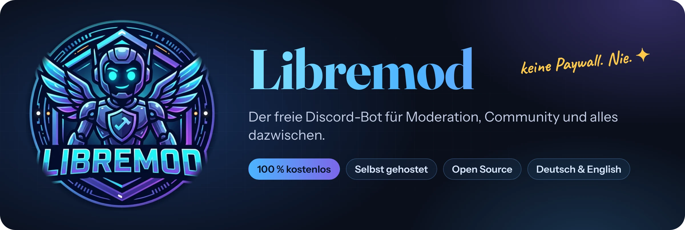
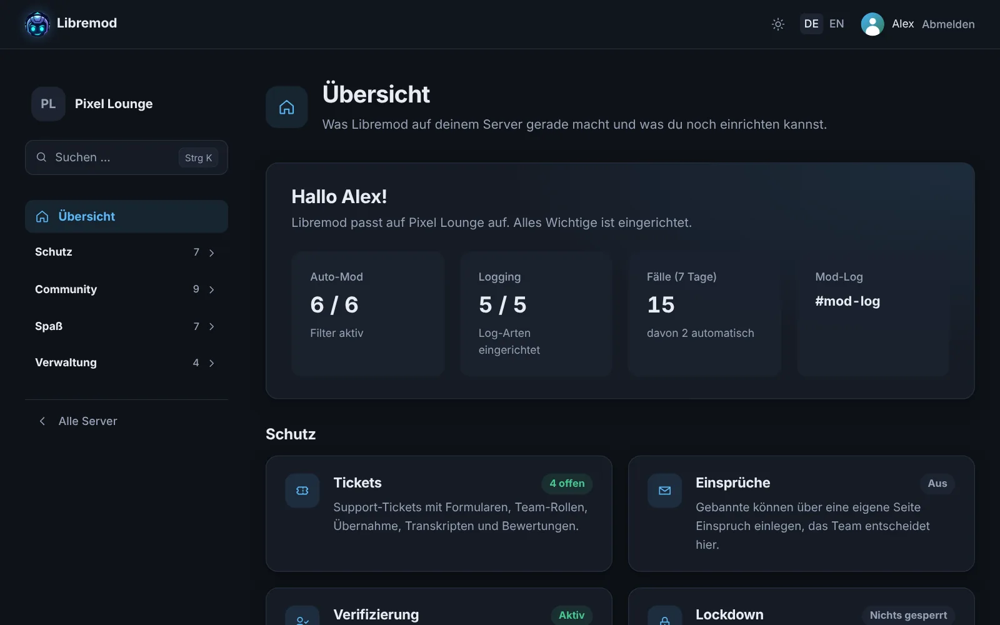
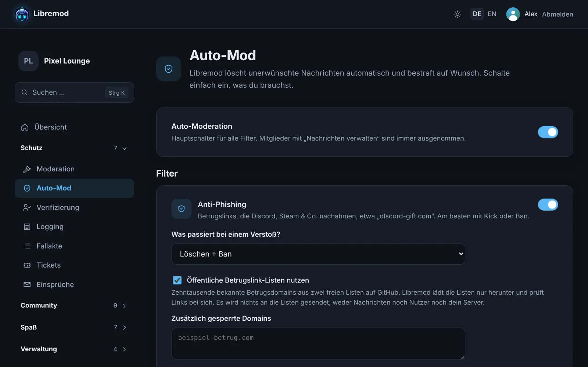
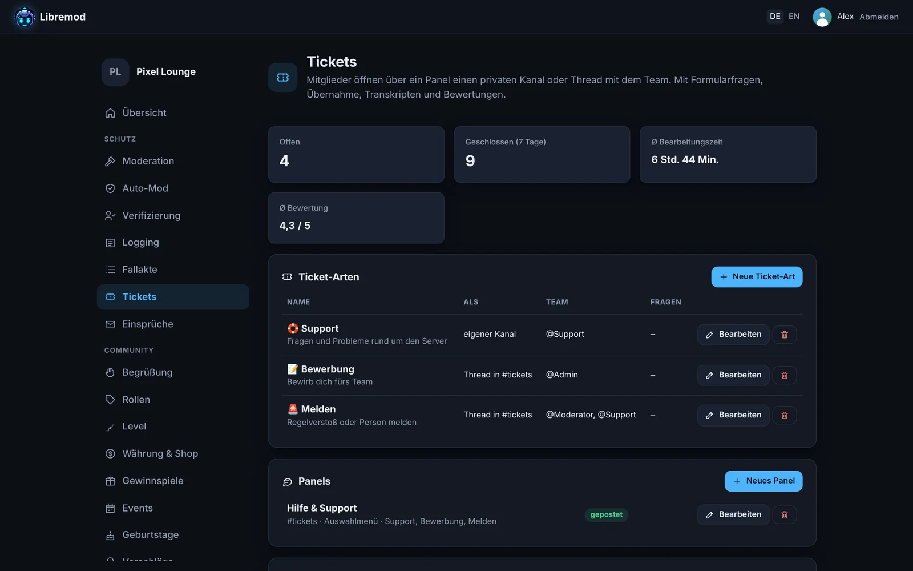
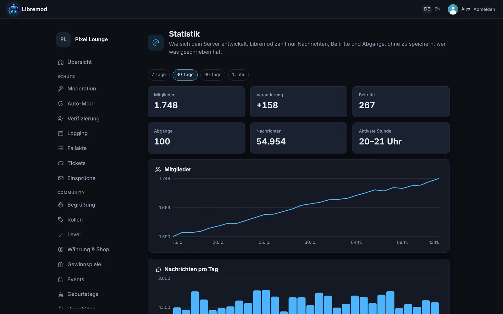
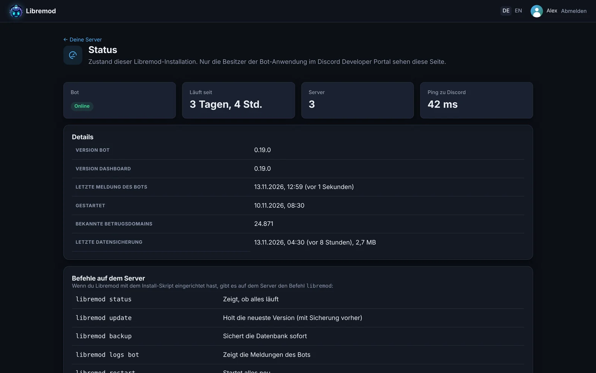
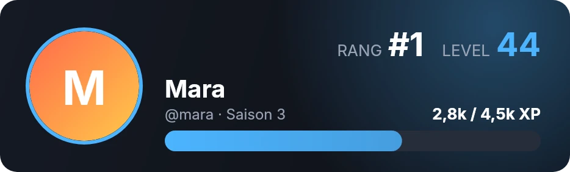
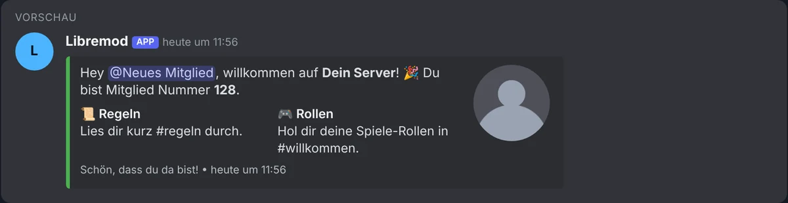

<div align="center">



<br>

[](LICENSE)
[](ROADMAP.md)
[](docs/SELBSTHOSTEN.md)
[](https://discord.js.org)
[](#warum-libremod)

**Deutsch** · [English](README.en.md)

[Funktionen](#funktionen) · [Screenshots](#so-sieht-es-aus) · [Installation](#installation-in-5-minuten) · [Befehle](#befehle) · [Datenschutz](#datenschutz) · [Mitmachen](#mitmachen)

</div>

---

Libremod moderiert deinen Discord-Server, begrüßt neue Mitglieder, verteilt XP und Rollen, verwaltet Tickets, verlost Preise und noch einiges mehr. Eingestellt wird alles bequem im **Web-Dashboard**.

Das Besondere: **Jede Funktion ist frei.** Keine Premium-Stufen, keine Limits, die man freikaufen muss, kein „Upgrade für 4,99 € im Monat“. Libremod läuft auf deinem eigenen Server, gehört dir und meldet nichts an irgendwen.

## Warum Libremod?

<table>
<tr>
<td width="50%" valign="top">

### 💸 Wirklich kostenlos
Bei vielen Bots sind die guten Sachen hinter einer Paywall: mehr Rollenbelohnungen, eigene Befehle, Begrüßungsbilder. Bei Libremod nicht. Alles ist für jeden Server freigeschaltet, für immer.

</td>
<td width="50%" valign="top">

### 🏠 Deine Daten bleiben bei dir
Libremod läuft auf deinem eigenen Server. Keine Telemetrie, kein zentraler Dienst, keine Werbung. Die Statistik zählt nur Zahlen, nicht wer was geschrieben hat.

</td>
</tr>
<tr>
<td width="50%" valign="top">

### ⚡ In 5 Minuten eingerichtet
Ein Install-Skript fragt alles ab, prüft deine Discord-Daten und richtet Datenbank, Dashboard, HTTPS und tägliche Sicherungen ein. Updates gehen mit einem Befehl.

</td>
<td width="50%" valign="top">

### 🌍 Deutsch und Englisch
Bot und Dashboard sprechen beide Sprachen. Die Sprache des Bots stellst du pro Server ein, Slash-Befehle sieht jede Person in ihrer eigenen Discord-Sprache.

</td>
</tr>
</table>

## So sieht es aus

<div align="center">

<sub><b>Übersicht</b>: was Libremod gerade auf deinem Server macht, auf einen Blick.</sub>
</div>

<br>

<table>
<tr>
<td width="50%"><br><sub><b>Auto-Mod</b>: Spam, Betrugslinks, Einladungen, Wortfilter und mehr.</sub></td>
<td width="50%"><br><sub><b>Tickets</b>: Ticket-Arten, Formulare, Transkripte, Bewertungen.</sub></td>
</tr>
<tr>
<td width="50%"><br><sub><b>Statistik</b>: Wachstum und Aktivität, ohne Inhalte zu speichern.</sub></td>
<td width="50%"><br><sub><b>Status</b>: Version, Verbindung und Sicherungen deiner Installation.</sub></td>
</tr>
</table>

<table>
<tr>
<td width="50%" align="center"><br><sub><code>/rank</code> zeigt eine Rang-Karte in deiner Wunschfarbe.</sub></td>
<td width="50%" align="center"><br><sub>Begrüßungsbild für jedes neue Mitglied.</sub></td>
</tr>
</table>

<div align="center">
<br>
<sub>Karten (Embeds) gestaltest du mit <b>Live-Vorschau</b> im Discord-Stil, mit Platzhaltern wie <code>{user}</code> und <code>{server}</code>.</sub>
</div>

## Funktionen

<table>
<tr>
<td width="50%" valign="top">

#### 🛡️ Schutz
- **Moderation**: Verwarnen, Timeout, Kick, Ban (auch befristet), Aufräumen, Fallakte mit Gründen
- **Verwarnungsstufen**: ab X Verwarnungen automatisch Timeout oder Ban
- **Auto-Mod**: Spam, Einladungen, Links, Wortfilter (auch gegen Tricks wie „1d10t“), Großbuchstaben, Massen-Erwähnungen
- **Anti-Phishing**: erkennt nachgemachte Discord- und Steam-Links, Kurzlinks und typische Betrugstexte, dazu zwei freie Listen mit Zehntausenden bekannten Betrugsdomains
- **Raid-Schutz** und **Namensschutz** gegen Leute, die sich als dein Team ausgeben
- **Verifizierung** neuer Mitglieder per Knopf, Code oder eigener Frage
- **Lockdown** einzelner Kanäle oder des ganzen Servers
- **Massenaktionen** gegen Raids, **Team-Notizen**, **Einsprüche** gegen Bans über eine eigene Seite
- **Logging**: gelöschte und bearbeitete Nachrichten, Beitritte, Rollen, Kanäle, Sprachkanäle

</td>
<td width="50%" valign="top">

#### 💬 Community
- **Begrüßung und Abschied** mit Karte, Begrüßungsbild und Direktnachricht
- **Rollen**: Auto-Rollen beim Beitritt, Rollen zum Selbstaussuchen per Knopf oder Menü, Rollen auf Zeit, Rolle im Sprachkanal
- **Tickets** mit Ticket-Arten, Formularfragen, Team-Rollen, Übernahme, Transkripten und Bewertungen
- **Eigene Befehle** wie `/regeln`, auf Wunsch mit Zufallsantworten
- **Geplante Nachrichten**: täglich, wöchentlich oder in festen Abständen
- **Benachrichtigungen** für YouTube, Twitch, Kick, Reddit und RSS
- **Vorschläge** mit Abstimmung, **Zitate**, **Highlights**
- **Temporäre Sprachkanäle**, **Zähler-Kanäle**, Kanäle automatisch leeren, automatischer Langsam-Modus

</td>
</tr>
<tr>
<td width="50%" valign="top">

#### 🎉 Spaß und Belohnungen
- **Level** für Nachrichten und Zeit im Sprachkanal, Rang-Karte, Rangliste, Rollenbelohnungen, Bonus-Rollen, Saisons mit Ruhmeshalle
- **Server-Währung** mit täglichem Bonus, Arbeiten, Überweisungen und einem **Shop** für Rollen und eigene Artikel
- **Gewinnspiele** mit Bedingungen und fairer Auslosung
- **Events** mit Zu- und Absagen, Warteliste und Erinnerung
- **Umfragen**, **Erinnerungen**, **Geburtstage**
- **Zähl-Kanal** und **Wortkette**

</td>
<td width="50%" valign="top">

#### ⚙️ Verwaltung
- **Web-Dashboard** mit Discord-Login, auch am Handy gut bedienbar
- **Team-Zugänge**: Moderatoren sehen nur die Bereiche, die du freigibst
- **Änderungsprotokoll**: wer hat wann was geändert
- **Statistik** zu Mitgliedern und Aktivität
- **Export und Import** aller Einstellungen, auch auf andere Server
- **Statusseite** und der Befehl `libremod` für Updates, Logs und Sicherungen
- **Deutsch und Englisch** im Bot und im Dashboard

</td>
</tr>
</table>

Was als Nächstes kommt und was in welcher Version dazukam, steht in der [Roadmap](ROADMAP.md).

## Installation in 5 Minuten

Du brauchst einen Linux-Server (Debian oder Ubuntu, 1 GB RAM reichen, auch ein Raspberry Pi geht) und einen Discord-Account.

**1. Bot bei Discord anlegen**

Im [Discord Developer Portal](https://discord.com/developers/applications) eine neue Anwendung anlegen. Unter **Bot** den Token kopieren und die beiden **Privileged Gateway Intents** *Server Members* und *Message Content* einschalten. Unter **OAuth2** das Client Secret kopieren.

**2. Install-Skript starten**

```bash
curl -fsSL https://raw.githubusercontent.com/libremod-bot/libremod/main/deploy/install.sh -o install.sh
sudo bash install.sh
```

Das Skript fragt Token und Client Secret ab, prüft sie bei Discord, installiert bei Bedarf Docker und richtet Datenbank, Dashboard, HTTPS (über Let's Encrypt) und eine tägliche Sicherung ein.

**3. Fertig**

Am Ende bekommst du die Adresse des Dashboards und einen Einladungslink für deinen Server. Die Redirect-Adresse, die das Skript anzeigt, trägst du noch im Developer Portal unter **OAuth2 → Redirects** ein.

> [!TIP]
> Die ausführliche Anleitung mit Screenshots aus dem Developer Portal, eigenem Webserver (nginx, Apache), Umzug und Hilfe bei Problemen findest du in **[docs/SELBSTHOSTEN.md](docs/SELBSTHOSTEN.md)**.

### Im Alltag: der Befehl `libremod`

| Befehl | Was er tut |
| --- | --- |
| `libremod status` | Zeigt, ob alles läuft, und wann zuletzt gesichert wurde |
| `libremod update` | Holt die neueste Version, vorher wird automatisch gesichert |
| `libremod logs bot` | Meldungen des Bots live ansehen |
| `libremod backup` / `restore` | Datenbank sichern oder eine Sicherung zurückspielen |
| `libremod config` | Einstellungen bearbeiten und neu starten |
| `libremod restart` | Alles neu starten |

<details>
<summary><b>Ohne Install-Skript: mit Docker Compose aus dem Quellcode</b></summary>

<br>

```bash
git clone https://github.com/libremod-bot/libremod.git
cd libremod
cp .env.example .env        # Token, Client-ID, Client Secret, Dashboard-Adresse und Passwörter eintragen
docker compose up -d --build
docker compose run --rm bot node dist/deploy-commands.js   # Slash-Befehle registrieren
```

Die Datenbank-Migrationen laufen beim Start des Bots automatisch. Das Dashboard lauscht nur lokal auf Port 3000 (`DASHBOARD_PORT`), davor gehört ein Reverse Proxy mit HTTPS. Im Developer Portal muss unter **OAuth2 → Redirects** `<DASHBOARD_URL>/api/auth/callback` eingetragen sein.

Fertige Images gibt es auch direkt: `ghcr.io/libremod-bot/libremod-bot` und `ghcr.io/libremod-bot/libremod-dashboard` (amd64 und arm64).

</details>

<details>
<summary><b>Livestream-Meldungen für Twitch und Kick einrichten</b></summary>

<br>

YouTube, Reddit und RSS-Feeds funktionieren ohne Zugangsdaten. Für Twitch und Kick braucht deine Installation eine eigene, kostenlose Anwendung bei der Plattform:

- **Twitch:** Unter [dev.twitch.tv/console/apps](https://dev.twitch.tv/console/apps) eine Anwendung anlegen (OAuth-Redirect z. B. `http://localhost`), dann `TWITCH_CLIENT_ID` und `TWITCH_CLIENT_SECRET` in die `.env` eintragen.
- **Kick:** Unter [kick.com/settings/developer](https://kick.com/settings/developer) eine Anwendung anlegen, dann `KICK_CLIENT_ID` und `KICK_CLIENT_SECRET` eintragen.

Danach `libremod restart`. Ohne diese Angaben ist die Plattform im Dashboard ausgegraut.

</details>

<details>
<summary><b>Welche Rechte braucht der Bot?</b></summary>

<br>

Der Einladungslink aus dem Dashboard fragt alle nötigen Rechte direkt an. Im Einzelnen:

- **Mitglieder kicken**, **bannen** und **im Timeout** für die Moderation
- **Nachrichten verwalten** und **Nachrichtenverlauf lesen** für Auto-Mod, Aufräumen, Highlights und Kanal-Leeren
- **Rollen verwalten** für Auto-Rollen, Rollen-Panels, Level-Belohnungen und Verifizierung
- **Kanäle verwalten** und **Mitglieder verschieben** für Zähler-Kanäle, temporäre Sprachkanäle, Lockdown und Langsam-Modus
- **Threads verwalten**, **private** und **öffentliche Threads erstellen**, **Nachrichten in Threads senden** für Tickets und Vorschläge
- **Nachrichten senden**, **Links einbetten**, **Dateien anhängen**, **Reaktionen hinzufügen**, **Umfragen erstellen**
- **@everyone erwähnen** nur, falls Benachrichtigungen das sollen

Die Rolle von Libremod muss in der Rollenliste über den Rollen stehen, die er vergeben oder moderieren soll.

</details>

## Befehle

Fast alles stellst du im Dashboard ein. Im Chat gibt es dazu diese Slash-Befehle:

<details open>
<summary><b>🛡️ Moderation und Schutz</b></summary>

<br>

| Befehl | Wofür |
| --- | --- |
| `/warn` | Verwarnung mit Grund |
| `/timeout`, `/untimeout` | Stummschalten für eine Dauer (z. B. `10m`, `2h`, `1d`) |
| `/kick` | Vom Server werfen |
| `/ban`, `/unban` | Bannen, auf Wunsch befristet (`dauer: 7d`), läuft selbst aus |
| `/purge` | Bis zu 100 Nachrichten aufräumen, optional nur von einer Person |
| `/cases`, `/case show/reason/revoke` | Fallakte ansehen, Gründe ändern, Verwarnungen zurücknehmen |
| `/lockdown channel/server`, `/unlock` | Kanäle oder den ganzen Server sperren, auf Wunsch befristet |
| `/massban`, `/masskick`, `/masstimeout` | Mehrere Personen auf einmal, z. B. alle, die in den letzten 10 Minuten beigetreten sind |
| `/note add/list/delete` | Team-Notizen zu Mitgliedern |
| `/modstats` | Wer im Team wie viele Fälle bearbeitet hat |
| `/verify` | Mitglied von Hand verifizieren |
| `/config`, `/automod`, `/logging` | Die wichtigsten Einstellungen auch direkt im Chat |

</details>

<details>
<summary><b>💬 Community</b></summary>

<br>

| Befehl | Wofür |
| --- | --- |
| `/ticket close/claim/add/remove/rename` | Tickets schließen, übernehmen, Leute hinzufügen oder entfernen |
| `/suggest`, `/suggestion status/delete` | Vorschläge einreichen und als Team entscheiden |
| `/temprole add/remove/list` | Rollen auf Zeit, z. B. 30 Tage VIP |
| `/quote add/random/show/delete` | Zitate speichern, auch per Rechtsklick → Apps → Als Zitat speichern |
| `/welcome test` | Begrüßung und Abschied zur Probe ansehen |

</details>

<details>
<summary><b>🎉 Level, Währung und Spaß</b></summary>

<br>

| Befehl | Wofür |
| --- | --- |
| `/rank`, `/leaderboard [saison]` | Rang-Karte als Bild, Rangliste, Endstand früherer Saisons |
| `/xp add/remove/set/reset` | XP von Mitgliedern verwalten (Team) |
| `/balance`, `/daily`, `/work`, `/pay` | Guthaben, täglicher Bonus, Arbeiten, Überweisen |
| `/shop`, `/buy`, `/inventory`, `/richlist` | Shop, Kaufen, gekaufte Artikel, Rangliste |
| `/coins add/remove/set` | Guthaben verwalten (Team) |
| `/giveaway start/end/reroll/list` | Gewinnspiele (Team) |
| `/event create/cancel/list` | Events mit Zusagen und Warteliste (Team) |
| `/poll` | Umfrage mit bis zu 10 Antworten |
| `/remind set/list/delete` | Erinnerungen im Kanal oder per Direktnachricht |
| `/birthday set/remove/show/list` | Geburtstag eintragen und die nächsten ansehen |

</details>

Dazu kommen die eigenen Befehle, die du im Dashboard anlegst.

## Datenschutz

- **Keine Telemetrie.** Libremod meldet nichts an die Entwickler, an libremod.xyz oder sonst wohin.
- **Nur nötige Verbindungen.** Der Bot spricht mit Discord, mit Kurzlink-Diensten (um zu prüfen, wohin ein Kurzlink führt), mit den Feeds, die ein Server-Team selbst einträgt, und mit den Betrugslink-Listen. Bilder und Videos lädt er nie herunter.
- **Sparsame Statistik.** Gezählt werden nur Nachrichten, Beitritte und Abgänge pro Tag, Kanal und Stunde, nicht wer was geschrieben hat. Die Zahlen werden nach 400 Tagen gelöscht, das Änderungsprotokoll nach einem Jahr.

<details>
<summary><b>Betrugslink-Listen</b></summary>

<br>

Das Anti-Phishing nutzt zusätzlich zur eigenen Erkennung zwei freie Listen bekannter Betrugsdomains. Libremod lädt sie alle 6 Stunden herunter und prüft Links lokal, es wird nichts an die Listen gesendet. Abschaltbar pro Server im Dashboard oder für die ganze Installation mit `PHISHING_LISTS=off`.

- [discord-phishing-links](https://github.com/nikolaischunk/discord-phishing-links) von nikolaischunk, MIT-Lizenz, Copyright (c) 2021 nikolaischunk
- [Discord-Phishing-URLs](https://github.com/Dogino/Discord-Phishing-URLs) von Dogino, Unlicense (gemeinfrei)

Danke an beide für ihre Arbeit. Die Listen sind nicht Teil dieses Repositorys und werden nicht mit Libremod ausgeliefert.

</details>

## Mitmachen

Ideen, Fehler und Wünsche gerne als [Issue](https://github.com/libremod-bot/libremod/issues). Pull Requests sind willkommen.

<details>
<summary><b>Entwicklungsumgebung einrichten</b></summary>

<br>

Voraussetzungen: Node.js 22, pnpm und Docker (für die Datenbank).

```bash
pnpm install
cp .env.example .env
# Lokale Test-Datenbank auf Port 5432 (Zugangsdaten wie in .env.example)
docker run -d --name libremod-db -p 127.0.0.1:5432:5432 \
  -e POSTGRES_USER=libremod -e POSTGRES_PASSWORD=bitte-aendern -e POSTGRES_DB=libremod \
  postgres:17-alpine
pnpm deploy-commands
pnpm dev:bot
pnpm dev:dashboard   # Dashboard auf http://localhost:3000
```

Vor einem Pull Request: `pnpm typecheck && pnpm build && pnpm test && pnpm i18n:check`.

| Ordner | Inhalt |
| --- | --- |
| `apps/bot` | Der Discord-Bot (TypeScript, discord.js) |
| `apps/dashboard` | Web-Dashboard mit Discord-Login (Next.js) |
| `packages/shared` | Gemeinsame Logik und Übersetzungen |
| `packages/db` | Datenbankschema und Migrationen (PostgreSQL, Drizzle) |
| `deploy` | Install-Skript und Docker-Dateien |

</details>

<details>
<summary><b>Übersetzungen</b></summary>

<br>

Texte stehen im Code auf Deutsch und laufen durch `t("…")`, in Bot, Dashboard und `packages/shared`. Der deutsche Text ist zugleich der Schlüssel, Platzhalter schreibst du als `{name}`: `t("Hallo {user}!", { user })`.

Die englischen Übersetzungen liegen in [`packages/shared/src/i18n/en.ts`](packages/shared/src/i18n/en.ts). Fehlt eine, erscheint der deutsche Text. `pnpm i18n:check` listet alle Texte ohne Übersetzung, `node scripts/i18n.mjs --unused` die Einträge, die nicht mehr gebraucht werden. Namen von Slash-Befehlen und Optionen bleiben im Code deutsch, ihre englischen Namen stehen im Wörterbuch unter `cmd:name`.

Lust auf eine weitere Sprache? Eine neue Datei neben `en.ts` und ein Eintrag in `LOCALES` reichen für den Anfang.

</details>

## Lizenz

Libremod steht unter der [GNU Affero General Public License v3.0](LICENSE). Du darfst es frei nutzen, verändern und weitergeben. Wer eine veränderte Version öffentlich betreibt, muss den Quellcode ebenfalls offenlegen. So bleibt Libremod für alle frei.

<div align="center">
<br>
<br>
<sub>Libremod · frei für jeden Server · <a href="https://libremod.xyz">libremod.xyz</a></sub>
</div>
